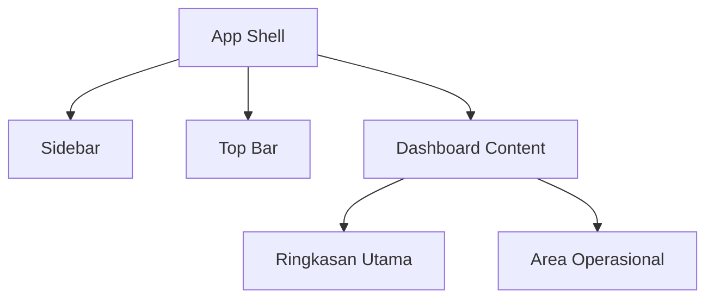

# Wireframe Detail Halaman Utama - Aplikasi Admin Kos

Dokumen ini adalah turunan dari PRD Aplikasi Admin Kos. Fokusnya hanya pada halaman utama untuk pemilik kos, yaitu dashboard setelah login.

## 1. Tujuan Halaman

Halaman utama harus menjawab pertanyaan penting dalam 10 detik pertama:

1. Berapa kamar yang terisi dan kosong?
2. Berapa pemasukan bulan ini?
3. Tagihan mana yang belum lunas?
4. Ada laporan kerusakan apa yang harus segera ditangani?
5. Apa aksi tercepat yang bisa dilakukan pemilik hari ini?

Secara sederhana, dashboard ini adalah pusat kendali kos. Pemilik tidak perlu membuka banyak menu untuk mengetahui kondisi operasional.

## 2. Pengguna Utama

| Role | Kebutuhan | Akses |
|---|---|---|
| Pemilik kos | Mengelola kamar, penghuni, tagihan, pembayaran, pengeluaran, dan laporan kerusakan | Penuh |
| Penghuni | Melihat tagihan, membayar, upload bukti, dan membuat laporan | Tidak masuk halaman ini |

Halaman ini hanya untuk pemilik kos. Penghuni akan memiliki dashboard sendiri di tahap berikutnya.

## 3. Konsep Visual

Nama gaya desain: Property Command Center.

Karakter tampilan:

- Modern, bersih, tapi tidak kaku seperti template admin biasa.
- Banyak ruang putih agar data mudah dibaca.
- Ada aksen warna yang memberi sinyal status kamar dan pembayaran.
- Denah kamar menjadi elemen visual utama agar aplikasi terasa spesifik untuk bisnis kos.
- Komponen dibuat ringkas supaya tetap nyaman digunakan di laptop dan HP.

## 4. Palet Warna Awal

| Fungsi | Warna | Keterangan |
|---|---|---|
| Background utama | `#F6F7F2` | Putih hangat, lebih lembut dari putih polos |
| Panel utama | `#FFFFFF` | Untuk card dan area data |
| Teks utama | `#1F2933` | Gelap tapi tidak terlalu keras |
| Teks sekunder | `#6B7280` | Untuk label dan deskripsi |
| Aksen utama | `#2563EB` | Tombol utama dan link penting |
| Sukses | `#16A34A` | Lunas, kamar terisi sehat |
| Peringatan | `#F59E0B` | Jatuh tempo, perlu dicek |
| Bahaya | `#DC2626` | Telat bayar, kerusakan urgent |
| Info lembut | `#E0F2FE` | Background badge ringan |

## 5. Struktur Layout Desktop

Ukuran acuan desktop: 1440 x 900.



### 5.1 App Shell

| Area | Ukuran | Isi |
|---|---:|---|
| Sidebar kiri | 260 px | Logo, menu utama, status properti |
| Top bar | Tinggi 72 px | Nama properti, pencarian, tombol aksi |
| Content | Sisa layar | Dashboard utama |

Catatan implementasi:

- Sidebar bisa dibuat fixed di desktop.
- Pada tablet dan mobile, sidebar berubah menjadi drawer.
- Content memiliki padding `24px` di desktop dan `16px` di mobile.

## 6. Wireframe Desktop Detail

### 6.1 Sidebar

Posisi: kiri layar.

Isi sidebar:

| Urutan | Komponen | Fungsi |
|---:|---|---|
| 1 | Logo aplikasi `KosPilot` | Identitas produk |
| 2 | Badge properti aktif | Menampilkan nama kos yang sedang dikelola |
| 3 | Menu Dashboard | Kembali ke halaman utama |
| 4 | Menu Kamar | Kelola kamar, harga, fasilitas, status |
| 5 | Menu Penghuni | Kelola data penghuni |
| 6 | Menu Tagihan | Kelola tagihan bulanan dan tahunan |
| 7 | Menu Pembayaran | Verifikasi bukti pembayaran |
| 8 | Menu Pengeluaran | Catat biaya operasional |
| 9 | Menu Kerusakan | Pantau laporan perbaikan |
| 10 | Menu Laporan | Ringkasan keuangan dan performa |
| 11 | Menu Pengaturan | Profil kos, rekening, preferensi |

State menu:

| State | Tampilan |
|---|---|
| Aktif | Background biru lembut, teks biru, ikon aktif |
| Hover | Background abu-abu lembut |
| Disabled | Teks abu-abu muda, tidak bisa diklik |

### 6.2 Top Bar

Posisi: bagian atas content.

Komponen:

| Komponen | Isi | Perilaku |
|---|---|---|
| Property switcher | `Kos Mawar Residence` | Untuk MVP hanya 1 properti, tetap tampil sebagai konteks |
| Ringkasan waktu | `Selasa, 28 Juli 2026` | Mengikuti waktu lokal |
| Search input | Cari kamar, penghuni, atau tagihan | Menampilkan hasil cepat |
| Tombol `Tambah Tagihan` | Aksi utama | Membuka modal tambah tagihan |
| Tombol profil | Avatar pemilik | Membuka menu akun |

Prioritas visual:

1. Nama properti.
2. Tombol tambah tagihan.
3. Search.
4. Profil.

### 6.3 Hero Status

Posisi: paling atas dalam content.

Tujuan: memberi konteks kondisi kos secara cepat.

Isi:

| Komponen | Contoh Data | Keterangan |
|---|---|---|
| Judul | `Selamat datang, Adam` | Sapaan pemilik |
| Subjudul | `Kos kamu punya 3 hal yang perlu dicek hari ini.` | Ringkasan insight |
| Alert chip 1 | `2 tagihan lewat jatuh tempo` | Link ke tagihan |
| Alert chip 2 | `1 laporan kerusakan urgent` | Link ke laporan |
| Alert chip 3 | `4 kamar kosong` | Link ke kamar kosong |

Microinteraction:

- Alert chip bisa di-hover.
- Saat diklik, dashboard scroll atau membuka halaman terkait.
- Jika tidak ada masalah, chip berubah menjadi status positif: `Semua aman hari ini`.

### 6.4 KPI Cards

Layout desktop: grid 4 kolom.

| Card | Data Utama | Data Pendukung | Aksi |
|---|---|---|---|
| Kamar Terisi | `18/24` | `75% okupansi` | Lihat kamar |
| Pemasukan Bulan Ini | `Rp 42.500.000` | `+8% dari bulan lalu` | Lihat laporan |
| Tagihan Belum Lunas | `Rp 7.200.000` | `5 penghuni` | Kejar tagihan |
| Kerusakan Aktif | `3 laporan` | `1 urgent` | Cek perbaikan |

Aturan warna:

| Kondisi | Warna |
|---|---|
| Nilai sehat | Hijau |
| Perlu perhatian | Kuning |
| Buruk atau telat | Merah |

State loading:

- Angka diganti skeleton shimmer.
- Icon tetap tampil agar layout tidak bergeser.

State empty:

- Jika belum ada kamar, card menampilkan `Belum ada data kamar`.
- Tombol utama berubah menjadi `Tambah kamar pertama`.

### 6.5 Panel Denah Kamar Interaktif

Posisi: area utama kiri, lebar sekitar 65% content.

Tujuan: membuat dashboard terasa benar-benar untuk kos, bukan dashboard keuangan biasa.

Isi panel:

| Komponen | Fungsi |
|---|---|
| Header `Denah Kamar` | Judul panel |
| Filter lantai | Pilih semua lantai, lantai 1, lantai 2 |
| Legend status | Terisi, kosong, jatuh tempo, maintenance |
| Grid kamar | Kotak kamar berdasarkan nomor |
| Tooltip kamar | Muncul saat hover atau tap |

Contoh status kamar:

| Status | Warna | Informasi |
|---|---|---|
| Terisi dan aman | Hijau | Penghuni aktif, tagihan lunas |
| Kosong | Abu-abu | Siap dipasarkan |
| Jatuh tempo | Kuning | Ada tagihan mendekati deadline |
| Telat bayar | Merah | Ada tagihan lewat jatuh tempo |
| Maintenance | Biru | Sedang diperbaiki |

Data pada kotak kamar:

| Elemen | Contoh |
|---|---|
| Nomor kamar | `A-01` |
| Nama pendek penghuni | `Raka` |
| Status kecil | `Lunas` |
| Harga | `1.5 jt/bln` |

Interaksi:

1. Klik kamar terisi membuka side panel detail kamar.
2. Klik kamar kosong membuka opsi `Tambah penghuni` atau `Edit kamar`.
3. Klik kamar bermasalah langsung menunjukkan penyebab, misalnya tagihan telat atau laporan kerusakan.

Side panel detail kamar:

| Bagian | Isi |
|---|---|
| Header | Nomor kamar, status, harga |
| Penghuni | Nama, nomor HP, tanggal masuk |
| Tagihan | Tagihan aktif, status pembayaran |
| Inventaris | Kasur, lemari, AC, kunci |
| Aksi | Edit kamar, tambah tagihan, pindahkan penghuni, buat laporan |

### 6.6 Panel Tagihan Prioritas

Posisi: kanan atas, lebar sekitar 35% content.

Tujuan: menampilkan tagihan yang paling perlu diperhatikan.

Isi:

| Urutan | Data |
|---:|---|
| 1 | Nama penghuni |
| 2 | Nomor kamar |
| 3 | Nominal tagihan |
| 4 | Status |
| 5 | Jatuh tempo |
| 6 | Tombol aksi |

Contoh item:

| Penghuni | Kamar | Nominal | Status | Aksi |
|---|---|---:|---|---|
| Raka | A-03 | Rp 1.500.000 | Telat 3 hari | Tandai lunas |
| Sinta | B-02 | Rp 1.700.000 | Jatuh tempo besok | Kirim pengingat |

Untuk MVP, tombol `Kirim pengingat` bisa menyalin template pesan WhatsApp, belum perlu integrasi otomatis.

Empty state:

Judul: `Tidak ada tagihan mendesak`

Deskripsi: `Semua tagihan bulan ini aman.`

Aksi: `Lihat semua tagihan`

### 6.7 Panel Keuangan Bulanan

Posisi: bawah denah kamar atau kanan tengah tergantung ukuran layar.

Isi:

| Komponen | Fungsi |
|---|---|
| Grafik mini pemasukan vs pengeluaran | Membandingkan performa bulan ini |
| Net profit | Pemasukan dikurangi pengeluaran |
| Breakdown kategori | Sewa, listrik, air, internet, maintenance |
| Link laporan | Masuk ke halaman laporan lengkap |

Data utama:

| Metrik | Rumus sederhana |
|---|---|
| Pemasukan | Total pembayaran lunas bulan berjalan |
| Pengeluaran | Total biaya operasional bulan berjalan |
| Profit | Pemasukan - pengeluaran |
| Collection rate | Tagihan lunas / semua tagihan |

Validasi tampilan:

- Jika belum ada pembayaran, grafik tetap muncul dengan empty state.
- Jika ada pengeluaran tanpa pemasukan, profit bisa negatif dan diberi warna merah.
- Semua angka rupiah harus diformat dengan pemisah ribuan.

### 6.8 Panel Laporan Kerusakan

Posisi: kanan bawah.

Tujuan: membuat perbaikan kamar tidak lupa ditangani.

Isi:

| Field | Contoh |
|---|---|
| Judul laporan | `AC tidak dingin` |
| Kamar | `B-01` |
| Pelapor | `Dimas` |
| Prioritas | `Urgent` |
| Status | `Menunggu dicek` |
| Waktu masuk | `2 jam lalu` |

Status laporan:

| Status | Makna |
|---|---|
| Baru | Laporan baru masuk |
| Dicek | Sedang diperiksa |
| Dikerjakan | Perbaikan sedang dilakukan |
| Selesai | Masalah sudah selesai |

Interaksi:

- Klik item membuka detail laporan.
- Tombol kecil `Ubah status` membuka menu pilihan status.
- Jika ada foto bukti, tampil thumbnail kecil.

### 6.9 Activity Feed

Posisi: bawah halaman.

Tujuan: memberi jejak aktivitas terbaru.

Contoh aktivitas:

| Aktivitas | Sumber |
|---|---|
| `Pembayaran Raka diverifikasi` | Pembayaran |
| `Tagihan Agustus dibuat untuk 18 penghuni` | Tagihan |
| `Kamar A-04 berubah menjadi kosong` | Kamar |
| `Laporan AC B-01 dibuat` | Kerusakan |

Aturan:

- Tampilkan maksimal 6 aktivitas terbaru.
- Jika lebih dari 6, tampilkan link `Lihat semua aktivitas`.
- Aktivitas sensitif tidak boleh menampilkan data berlebihan.

## 7. Layout Mobile

Ukuran acuan mobile: 390 x 844.

Perubahan layout:

| Desktop | Mobile |
|---|---|
| Sidebar kiri | Bottom navigation atau drawer |
| KPI 4 kolom | Scroll horizontal atau grid 2 kolom |
| Denah kamar besar | Menjadi card full width |
| Panel kanan | Turun ke bawah |
| Top search lebar | Icon search membuka overlay |

Urutan mobile:

1. Top bar ringkas.
2. Hero status.
3. KPI cards.
4. Denah kamar.
5. Tagihan prioritas.
6. Laporan kerusakan.
7. Keuangan bulan ini.
8. Activity feed.

Bottom navigation mobile:

| Tab | Fungsi |
|---|---|
| Dashboard | Halaman utama |
| Kamar | Data kamar |
| Tagihan | Tagihan dan pembayaran |
| Laporan | Kerusakan dan laporan |
| Akun | Profil dan pengaturan |

## 8. Empty State Utama

Empty state muncul ketika pemilik baru pertama kali memakai aplikasi.

Kondisi awal:

- Belum ada kamar.
- Belum ada penghuni.
- Belum ada tagihan.
- Belum ada pembayaran.

Tampilan yang disarankan:

| Area | Isi |
|---|---|
| Hero | `Bangun pusat kontrol kos pertamamu` |
| Deskripsi | `Mulai dari menambahkan kamar, lalu undang penghuni untuk masuk ke portal mereka.` |
| Aksi utama | `Tambah kamar pertama` |
| Aksi sekunder | `Import data dari Excel` |
| Checklist setup | Profil kos, kamar, penghuni, rekening, aturan tagihan |

Checklist onboarding:

| Step | Status Awal |
|---|---|
| Lengkapi profil kos | Belum |
| Tambah data kamar | Belum |
| Tambah penghuni | Belum |
| Buat tagihan pertama | Belum |
| Atur rekening pembayaran | Belum |

## 9. Loading State

Loading harus terasa stabil, bukan layar kosong.

| Area | Loading |
|---|---|
| Top bar | Nama properti skeleton |
| KPI card | Skeleton angka dan label |
| Denah kamar | Grid skeleton |
| Tagihan prioritas | List skeleton 3 baris |
| Keuangan | Skeleton grafik |
| Kerusakan | Skeleton list |

Aturan:

- Jangan menampilkan angka `0` sebelum data selesai dimuat.
- Skeleton maksimal tampil 1 sampai 2 detik jika data cepat.
- Jika gagal load, tampilkan error state yang jelas.

## 10. Error State

Error yang perlu ditangani:

| Error | Pesan Sederhana | Aksi |
|---|---|---|
| Gagal mengambil data dashboard | `Data dashboard belum bisa dimuat.` | Coba lagi |
| Koneksi bermasalah | `Periksa koneksi internet kamu.` | Retry |
| Sesi login habis | `Sesi kamu sudah berakhir.` | Login ulang |
| Data tidak valid | `Ada data yang perlu diperbaiki.` | Lihat detail |

Prinsip:

- Jangan tampilkan error mentah dari server ke pengguna.
- Error teknis dicatat di log server.
- Pengguna hanya melihat pesan yang bisa dipahami.

## 11. Quick Actions

Quick actions adalah tombol cepat untuk tugas yang sering dilakukan.

| Aksi | Lokasi | Fungsi |
|---|---|---|
| Tambah Kamar | Hero atau empty state | Membuat kamar baru |
| Tambah Penghuni | Denah kamar kosong | Menambahkan penyewa |
| Buat Tagihan | Top bar | Membuat tagihan bulanan/tahunan |
| Catat Pembayaran | Tagihan prioritas | Verifikasi pembayaran |
| Catat Pengeluaran | Keuangan | Input biaya operasional |
| Buat Laporan | Kerusakan | Mencatat masalah kamar |

Urutan prioritas tombol:

1. `Buat Tagihan`
2. `Tambah Penghuni`
3. `Catat Pembayaran`
4. `Catat Pengeluaran`

## 12. Komponen UI yang Dibutuhkan

| Komponen | Lokasi File Nanti | Fungsi |
|---|---|---|
| `DashboardShell` | `src/components/layout/dashboard-shell.tsx` | Struktur sidebar dan content |
| `SidebarNav` | `src/components/layout/sidebar-nav.tsx` | Menu navigasi |
| `TopBar` | `src/components/layout/top-bar.tsx` | Header atas |
| `HeroStatus` | `src/features/dashboard/components/hero-status.tsx` | Sapaan dan alert |
| `KpiCard` | `src/features/dashboard/components/kpi-card.tsx` | Card statistik |
| `RoomMap` | `src/features/rooms/components/room-map.tsx` | Denah kamar |
| `PriorityBills` | `src/features/billing/components/priority-bills.tsx` | Tagihan prioritas |
| `MonthlyFinance` | `src/features/finance/components/monthly-finance.tsx` | Keuangan bulan ini |
| `MaintenanceList` | `src/features/maintenance/components/maintenance-list.tsx` | Laporan kerusakan |
| `ActivityFeed` | `src/features/dashboard/components/activity-feed.tsx` | Aktivitas terbaru |
| `EmptyDashboard` | `src/features/dashboard/components/empty-dashboard.tsx` | Tampilan awal |

## 13. Data yang Dibutuhkan Dashboard

Endpoint atau server action nanti perlu mengembalikan data ringkas seperti ini:

```ts
type DashboardSummary = {
  property: {
    id: string;
    name: string;
    address: string;
  };
  roomStats: {
    total: number;
    occupied: number;
    vacant: number;
    maintenance: number;
    occupancyRate: number;
  };
  finance: {
    currentMonthIncome: number;
    currentMonthExpense: number;
    currentMonthProfit: number;
    collectionRate: number;
  };
  billing: {
    unpaidTotal: number;
    overdueCount: number;
    dueSoonCount: number;
  };
  maintenance: {
    activeCount: number;
    urgentCount: number;
  };
};
```

Data list yang dibutuhkan:

```ts
type DashboardLists = {
  rooms: RoomMapItem[];
  priorityBills: PriorityBillItem[];
  activeMaintenance: MaintenanceItem[];
  recentActivities: ActivityItem[];
};
```

## 14. Aturan Validasi Data

| Data | Aturan |
|---|---|
| Nama properti | Wajib, minimal 3 karakter |
| Nomor kamar | Wajib, unik dalam properti |
| Harga kamar | Wajib, lebih dari 0 |
| Status kamar | Harus salah satu dari `vacant`, `occupied`, `maintenance` |
| Nama penghuni | Wajib |
| Nominal tagihan | Wajib, lebih dari 0 |
| Jatuh tempo | Wajib, format tanggal valid |
| Status pembayaran | `unpaid`, `pending`, `paid`, `overdue` |

## 15. Keamanan dan Privasi

Hal penting untuk dashboard:

1. Pemilik hanya bisa melihat data properti miliknya.
2. Penghuni tidak boleh bisa membuka halaman dashboard pemilik.
3. Semua query database harus difilter berdasarkan `owner_id`.
4. Bukti pembayaran tidak boleh bisa diakses publik tanpa aturan akses.
5. Data kontak penghuni jangan ditampilkan berlebihan di activity feed.
6. Server harus memvalidasi ulang setiap aksi, bukan hanya validasi di frontend.

## 16. Acceptance Criteria

Halaman dashboard dianggap selesai jika:

| Kriteria | Harus Terpenuhi |
|---|---|
| Tampilan desktop rapi | Tidak ada komponen saling menimpa |
| Tampilan mobile rapi | Semua panel bisa dibaca di layar kecil |
| Data ringkasan tampil | Kamar, pemasukan, tagihan, kerusakan muncul |
| Empty state tersedia | Pemilik baru tahu langkah pertama |
| Loading state tersedia | Tidak ada layar putih saat data dimuat |
| Error state tersedia | Pengguna tahu apa yang harus dilakukan |
| Denah kamar interaktif | Klik kamar membuka detail |
| Aksi utama jelas | Tambah tagihan, tambah penghuni, catat pembayaran |
| Format rupiah benar | Contoh `Rp 1.500.000` |
| Role aman | Penghuni tidak bisa melihat dashboard pemilik |

## 17. Prioritas Pembuatan UI

Milestone UI halaman utama:

1. Buat layout shell: sidebar, top bar, content.
2. Buat KPI cards dengan data dummy.
3. Buat denah kamar dengan data dummy.
4. Buat panel tagihan prioritas.
5. Buat panel laporan kerusakan.
6. Buat panel keuangan bulanan.
7. Buat empty, loading, dan error state.
8. Sambungkan ke database setelah tampilan stabil.

## 18. Catatan Untuk Implementasi Next.js

Stack yang cocok:

| Bagian | Pilihan |
|---|---|
| Framework | Next.js App Router |
| Bahasa | TypeScript |
| Styling | Tailwind CSS |
| Komponen | shadcn/ui, dikustom sesuai identitas |
| Icon | lucide-react |
| Validasi | Zod |
| Database | Supabase PostgreSQL |
| Auth | Supabase Auth |

Prinsip coding:

- Mulai dari data dummy agar UI cepat terlihat.
- Setelah layout bagus, baru sambungkan ke Supabase.
- Pisahkan komponen per fitur supaya mudah dipelajari.
- Jangan simpan API key di source code.
- Gunakan `.env.local` untuk credential lokal.

## 19. Ringkasan Bentuk Halaman

Urutan tampilan desktop:

1. Sidebar navigasi.
2. Top bar properti dan aksi cepat.
3. Hero status harian.
4. KPI cards.
5. Denah kamar interaktif.
6. Tagihan prioritas.
7. Keuangan bulanan.
8. Laporan kerusakan.
9. Aktivitas terbaru.

Urutan tampilan mobile:

1. Top bar ringkas.
2. Hero status.
3. KPI cards.
4. Denah kamar.
5. Tagihan prioritas.
6. Laporan kerusakan.
7. Keuangan bulanan.
8. Aktivitas terbaru.
9. Bottom navigation.

## 20. Rekomendasi Langkah Berikutnya

Setelah wireframe ini, langkah paling masuk akal adalah membuat mockup UI low-fidelity di kode Next.js dengan data dummy.

Target milestone berikutnya:

- Membuat project Next.js.
- Membuat halaman `/dashboard`.
- Membuat layout dashboard responsive.
- Membuat komponen awal sesuai daftar komponen di dokumen ini.
- Menggunakan data dummy dulu agar desain bisa diuji tanpa database.

